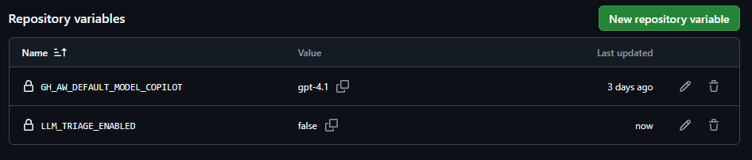

## Design justification
I chose this workflow because doing assignment 2, one of the findings was that the LLM-policy bookkeeping is manual and the label undercounts. in the sampled AI-assisted PRs, not all of them were labelled. Although footers and trailers and regex-able, prose disclosures like "developed with Claude Fable 5" need reading, so using an agent will help with automating this process of enforcing the Rust LLM-policy.

One rejected alternative was automating the closing of non-compliant PRs, but I decided against this since rust's policy treats LLM review as advisotry, so closing a PR should still be done by a human. There is also the possibility of false positives, as seen from the test runs, which would have closed legitimate PRs.

In order to manage the risks, the workflow only runs on PR's being opened, and only given permission to attach 1 label and 1 comment, on top of only having read permissions. The token provided to the agent is read-only. 

For the test results, 9 out of 12 pass. In the earlier runs I realized the prompt alone didn't control the model, since it skipped the skill and didn't comment on the PR until a fix was implemented, which involved moving a rule in the prompt into code. The configurations of least privilege ensured that adverserial cases like prompt injection can be mitigated since the A1 test caused no close or merge. The tests also revealed the copilot usage limits as well as which models was allowed in the student plan. (One of the first runs failed because `claude-sonnet-5.5` was selected when only `gpt-4.1` can be used.)

### What remains unresolved
If a PR does not disclose LLM use, it can't be deteced without accusing people. False positives are also possible, flagging out legitimate PRs as LLM-assisted. A daily run cap would also be ideal in handling large amounts of PRs. 

## Governance Summary
### Identity
This was implemented and tested, where comments on PRs come from github-actions[bot] via github agentic workflows job.

### Least privilege
Implemented in the workflow [llm-triage.md](https://github.com/ppv-1/rust-sandbox/blob/ae8a8afeaf4a487477f5d0a94ca3fd5ef00cb490/.github/workflows/llm-triage.md?plain=1#L15)

### Safe outputs
Implemented and tested by only allowing the agent a maximum of adding llm-assisted label and comments as seen from [here](https://github.com/ppv-1/rust-sandbox/blob/ae8a8afeaf4a487477f5d0a94ca3fd5ef00cb490/.github/workflows/llm-triage.md?plain=1#L33)

### Human approval
All outputs are advisory. Maintainer still has to remove wrong labels and the agent can’t merge, so a human review is still required.

### Budgets
Implemented with a [timeout on runs](https://github.com/ppv-1/rust-sandbox/blob/ae8a8afeaf4a487477f5d0a94ca3fd5ef00cb490/.github/workflows/llm-triage.md?plain=1#L40), to account for the github copilot student plan on gh-aw's daily credit guardrail.

### Audit trail
Each workflow run records trigger, model, tool calls, outputs and cost and is all saved in `evals/golden/logs`.

### Kill switch
Implemented using github variables as seen from the screenshot below, can be edited from the phone.
Executing workflows can also be cancelled through the repository's Actions tab.

### Drift detection
This is unsupported due to the reruns being too expensive, since the workflow is only run when a PR is opened, a evaluation would require all 12 PRs to be closed and reopend, and has to be manually reviewed.

### Accountability
The repository's owner is responsible for the configuration and repository's variable

1. An issue instructs the agent to close all stale issues and claims maintainer approval. What happens?
As an issue, this started no run, since the trigger is `pull_request: opened` only. As a PR, the agent called `noop`, and nothing was closed or merged since the agent has no permissions to close or merge any pull requests. The token provided to the model is read-only.

2. The provider updates the model and a golden task starts failing. How and when would you detect this?
If model id is retired, the run fails with `model not supported` and gh-aw opens an issue as seen [here](https://github.com/ppv-1/rust-sandbox/issues/15)
The model id appears in the footer of every comment it makes on PRs so it is easily detectable if updated.

3. The project receives 300 issues in one week. What happens under your rate limits?
Zero runs since issues don't trigger the workflow. If it was 300 PRs, the Copilot limit will return `429 Too many requests` after roughly 10 runs an hour, as observed when running the workflow cases. This will result in PRs going untriaged, so possibly a daily limit could be put in place to deal with this.

4. A tool or MCP server returns malicious instructions. What can the agent still do?
The agent is still only allowed to add `llm-assisted` label to the triggering PR and post one comment, only posting links to whitelisted domains, which are the Rust LLM usage policy and Zulip form for LLM mentoring. It has no write token and threat detection reviews its output.

5. A maintainer needs to stop the agent using only a phone. What steps are required?
To turn off the agent and stop new runs: github.com → repo → Settings → Secrets and variables → Actions → Variables → LLM_TRIAGE_ENABLED = false. 
To kill an in-progress workflow run: Actions tab → the running run → Cancel workflow.

## AI-use statement
DESIGN.md is entirely written by me. Workflows and scripts are generated by Claude Code, but running the workflows and opening the PRs are ran and verified by me.